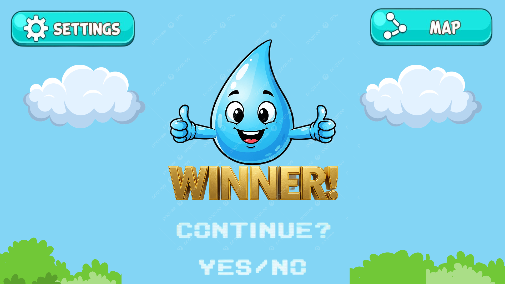

# LA MISIÓN DE LAS GOTITAS

## Capturas del juego

### Pantalla 1: Inicio

Descripción de la pantalla.

### Pantalla 5: Victoria

Esta es la pantalla que aparece cuando el jugador gana el nivel. En el centro sale la gotita feliz con los dos pulgares arriba y, debajo, el letrero dorado "WINNER!" para felicitar al jugador. Más abajo aparece la pregunta "CONTINUE?" con las opciones YES o NO, para que el jugador decida si sigue jugando o si sale del juego. Arriba a la izquierda está el botón "SETTINGS" para abrir la configuración y arriba a la derecha el botón "MAP" para ver el mapa del juego. El fondo es un cielo azul con nubes y arbustos verdes, para mantener el mismo estilo alegre de las demás pantallas.

## Diseño de pantallas
Puedes ver el diseño completo aquí: [Diseño en Figma](PEGA-AQUÍ-EL-LINK)

## Autores

| Nombre | Contacto en GitHub |
|--------|--------------------|
| Ximena Itzel Cruz Espinosa | [Ximena-Cruz-Dev](https://github.com/Ximena-Cruz-Dev) |
| Davia Oliva Mendoza | [usuario-de-Davia]() |
| Melany Esquivel Caballero | [usuario-de-Melany]() |
