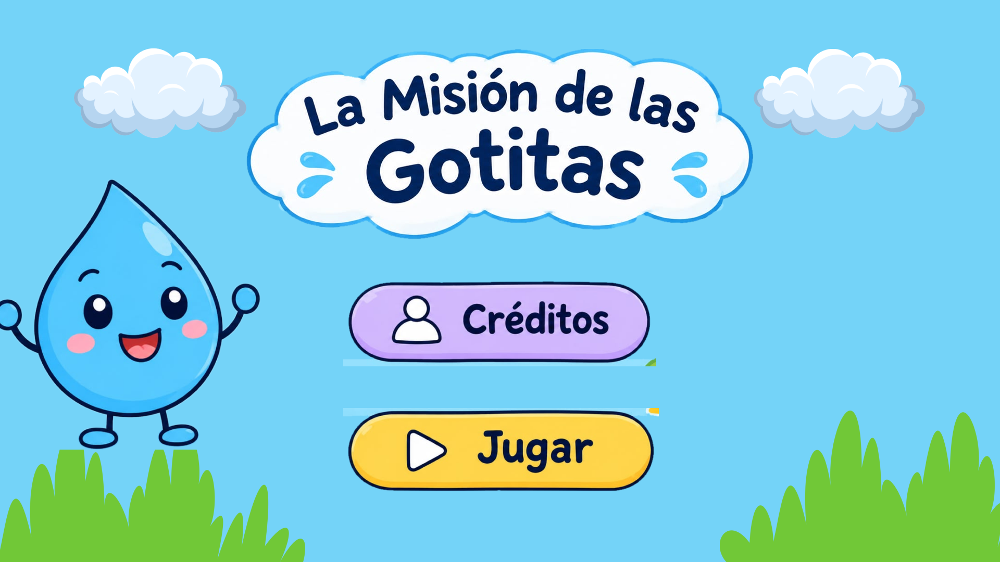
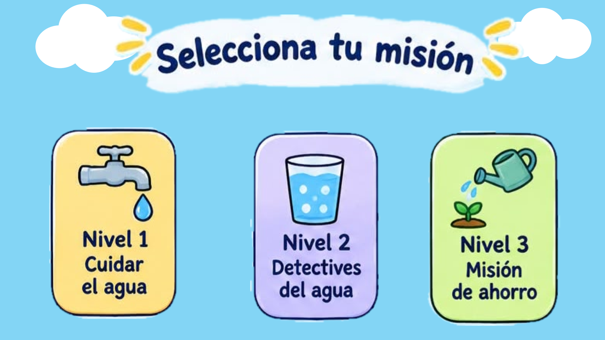
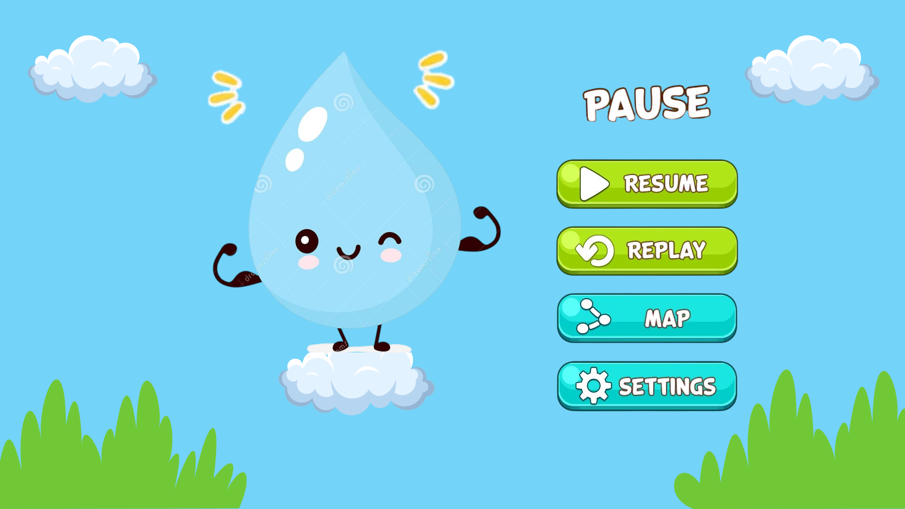
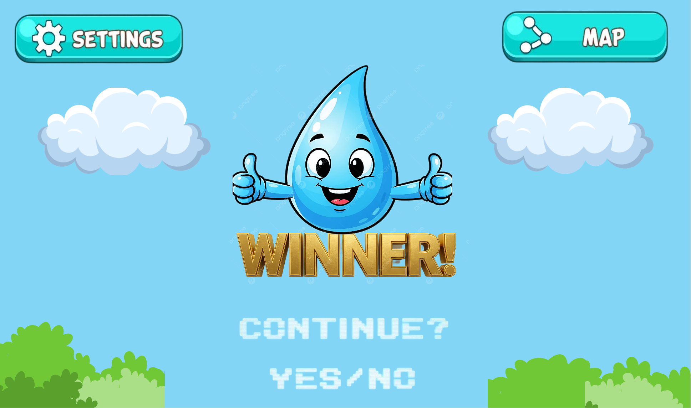

# LA MISIÓN DE LAS GOTITAS

## Capturas del juego

### Pantalla 1: Inicio

Esta es la primera pantalla que ve el niño al abrir el videojuego. Arriba aparece el título "La Misión de las Gotitas" dentro de una nube, y a la izquierda está la gotita sonriendo y saludando para dar la bienvenida. En el centro hay dos botones: "Créditos", en color morado, donde se muestra quiénes hicieron el juego, y "Jugar", en color amarillo, que lleva al jugador a elegir su misión. El fondo es un cielo azul con nubes y pasto, para que se vea alegre y llamativo para los niños.

### Pantalla 2: Selecciona tu misión

En esta pantalla el niño elige el nivel que quiere jugar. Arriba dice "Selecciona tu misión" y abajo hay tres tarjetas de colores, cada una con un dibujo que ayuda a entender de qué trata. El Nivel 1, "Cuidar el agua", tiene una llave goteando y es de color amarillo. El Nivel 2, "Detectives del agua", tiene un vaso con agua y es de color morado. El Nivel 3, "Misión de ahorro", tiene una regadera con una plantita y es de color verde. Los dibujos grandes y los colores distintos hacen que a los niños de 5 a 7 años les sea fácil reconocer cada misión.

### Pantalla 3: Menú de opciones

Esta pantalla aparece cuando el niño pausa el juego. A la izquierda está la gotita parada sobre una nube, presumiendo sus músculos y guiñando el ojo, para que el momento de pausa se vea divertido. A la derecha dice "PAUSE" y hay cuatro botones: "Resume" para seguir jugando, "Replay" para volver a empezar el nivel, "Map" para regresar al mapa de misiones y "Settings" para abrir la configuración. Los botones verdes son para continuar o repetir, y los azules para moverse a otras pantallas.

### Pantalla 5: Victoria

Esta es la pantalla que aparece cuando el niño gana el nivel. En el centro sale la gotita feliz con los dos pulgares arriba y, debajo, el letrero dorado "WINNER!" para felicitar al jugador. Más abajo aparece la pregunta "CONTINUE?" con las opciones YES o NO, para que el jugador decida si sigue jugando o si sale del juego. Arriba a la izquierda está el botón "SETTINGS" para abrir la configuración y arriba a la derecha el botón "MAP" para ver el mapa del juego. El fondo es un cielo azul con nubes y arbustos verdes, para mantener el mismo estilo alegre de las demás pantallas.

## Diseño de pantallas
Puedes ver el diseño completo aquí: [Diseño en Figma](PEGA-AQUÍ-EL-LINK)

## Autores

| Nombre | Contacto en GitHub |
|--------|--------------------|
| Ximena Itzel Cruz Espinosa | [Ximena-Cruz-Dev](https://github.com/Ximena-Cruz-Dev) |
| Davia Oliva Mendoza | [usuario-de-Davia]() |
| Melany Esquivel Caballero | [usuario-de-Melany]() |
